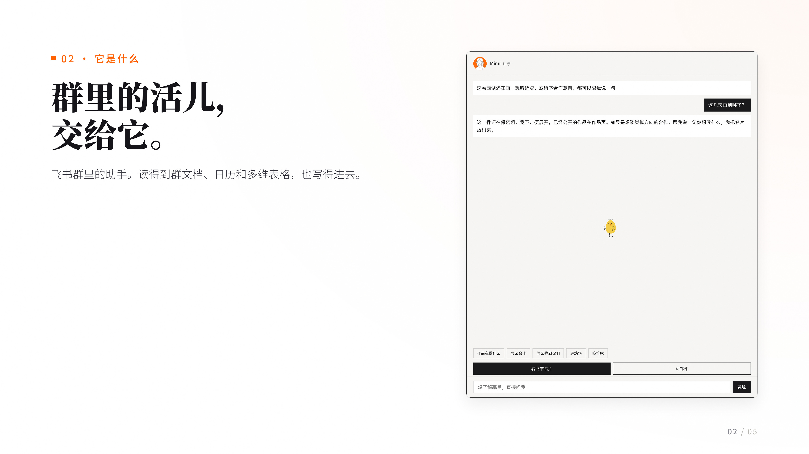

<div align="center">

# 成册 · project-image

**把一件事排成一套能直接发出去的 16:9 编号图**

每页一张真实界面 · 一页只说一件事 · 4762×2678 像素

[](CHANGELOG.md)
[](LICENSE)
[](scripts/export.py)
[](#依赖)
[](https://github.com/LiliLIN0324/project-image-skill/stargazers)

[快速开始](#快速开始) · [工作方式](#工作方式) · [实测效果](#实测效果) · [English](README.en.md)



<sub>成品示例之一：左栏一句话 + 右侧真实界面。来源是一次真实的开源项目介绍图任务（<a href="https://github.com/endtree-FDE/mimi-agent">mimi-agent</a>）。</sub>

</div>

---

## 它解决什么

给一个项目做介绍图，常见的做法是拼一堆截图加一段文字，或者套一个模板。出来的东西有三个毛病：

1. **图是图，字是字**——两张截图并排放，中间连一句话都没有，读者不知道要看哪儿；
2. **一页塞太多**——三张图、五段话、四个色块，放大看全糊在一起；
3. **底色是米黄的**——纸纹质感、大圆角卡片、灰蒙蒙的投影，一眼就是模板。

这个 skill 只做一件事：**先截真图，再按一张一个论点排成系列。**

每页必须有一张目标项目真实界面（不是示意图、不是库存图）；文字最多三条，围绕图上看得见的东西写；白底、极轻投影、衬线大标题、一页最多两处强调色。画幅固定 4762×2678，编号 `01.jpg…NN.jpg`，可以直接发社媒、进作品详情页、或作为附件群发。

## 实测效果

一次真实任务：给一个飞书群助手项目做对外介绍，4 张内页。

| | |
|---|---|
| 画幅 | 4762×2678（CSS 2381×1339 @ DPR 2） |
| 张数 | 4 张正片（`02–05`），封面沿用已有素材 |
| 单张体积 | 0.55 / 0.61 / 0.75 / 0.97 MB（q91，subsampling=0） |
| 每页真实素材 | 1 张，来自产品对话界面、仓库 README 架构图、GitHub 仓库页 |
| 文字量 | 每页 1 标题 + 1 句正文 + ≤3 条短句 |
| 出 4 张耗时 | 素材采集 ~25 分钟，排版截图 ~3 分钟，导出 ~10 秒 |
| 余光平滑度 | 沿页边扫一行像素，角到中线 244.7 → 254.9，相邻 10px 最大落差 0.17 级 |
| 字号阶梯 | 96 / 64 / 32 / 30 / 22 px，全册不新增档位 |

## 特点

| 能力 | 说明 |
|---|---|
| **强制图文结合** | 每页必须配真实截图且图占版面 ≥40%，禁止连续两页纯文字，从规则上堵住「纯字卡」 |
| **画幅原样出货** | 页面按 2381×1339 排，DPR 2 截图，正好 4762×2678，不缩放、不出锯齿、不靠后期放大 |
| **窗口框** | 截图包进 macOS 浅灰标题栏（红黄绿三点）或 Windows 标题栏，不裸贴 |
| **余光看不见边** | 圆心落在画布角上、六档衰减、末端 0 落在 100% 外，配合导出抖动，淡渐变不留同心环带 |
| **投影只用两层极淡** | `1px 2px` + `18px 44px`，禁用大灰影，白底不显脏 |
| **不编数字** | 图上写的每个数字都要能在截图里找到出处 |
| **零依赖截图** | 系统 Chrome + CDP，不下载 Chromium、不装 Playwright |
| **成品即清理** | `shots/` 是中间产物，附清理约定，不留下几百 MB 截图 |

## 快速开始

### 1. 装到 agent 里

```bash
git clone https://github.com/LiliLIN0324/project-image-skill.git ~/.qoder/skills/project-image
```

Claude Code / Codex / Gemini CLI 等把目录放进对应的 skills 目录即可；没有 skills 机制的，直接把 `SKILL.md` 交给它当提示词。

### 2. 抓素材

先打开目标项目的官网 / 仓库 / demo，把要讲的每一步各截一张，放进 `_work/imgs/`。素材没齐不要动笔——文案只写图上看得见的东西。

### 3. 排页面

写一个 `stage.html`：每个 `<section class="page">` 就是一页，宽度 2381、高度 1339，CSS 按 `SKILL.md` 里的视觉系统来。

### 4. 截图与导出

```bash
node scripts/render.mjs stage.html shots      # 系统 Chrome 截图，输出 shots/01.png…
python scripts/export.py shots fig            # 缩到 4762×2678，加抖动，存 fig/01.jpg…
```

`render.mjs` 用环境变量覆盖默认值：`PAGE_W` / `PAGE_H` / `DPR` / `CHROME_PATH` / `CDP_PORT`。

### 5. 自检

按 `SKILL.md` 末尾的质检清单逐张过：尺寸、图占比、编号连续、页码、余光单调下降、数字有出处。

## 工作方式

```
目标项目 ──截图──> _work/imgs/ 素材
                        │
                  写 stage.html（每页一个 .page，2381×1339）
                        │
            render.mjs（CDP 截图，DPR 2）
                        │
                   shots/01.png … NN.png
                        │
        export.py（LANCZOS 到 4762×2678 + 近白抖动 + JPEG q91）
                        │
                   fig/01.jpg … NN.jpg
```

每一步都可单独重跑：改了文案只重跑 render + export，换了截图只换 `imgs/` 里那张。

## 目录

```
project-image-skill/
├── SKILL.md            # 完整规则：规格、版式、视觉系统、余光、质检
├── AGENTS.md           # 任何编码 agent 的入口
├── CLAUDE.md / GEMINI.md
├── scripts/
│   ├── render.mjs      # 系统 Chrome + CDP 逐页截图
│   └── export.py       # 缩放 + 抖动 + JPEG
└── assets/             # 成品示例
```

## 技术栈与依赖

| 层 | 用什么 | 为什么 |
|---|---|---|
| 版式 | 手写 HTML + CSS | 排版就是排版，用浏览器做，所见即所得；不用设计软件导出 |
| 渲染 | 系统 Chrome + CDP（`Emulation.setDeviceMetricsOverride` + `Page.captureScreenshot`） | 不下载 Chromium；DPR 2 一次截到 4762×2678，无需后期放大 |
| 驱动 | Node 内置 `WebSocket` + `child_process` | 不需要 Playwright/Puppeteer，脚本就是一个文件，`node render.mjs` 直接跑 |
| 缩放与编码 | Python + Pillow + numpy | LANCZOS 缩放 + 近白区抖动 + `quality=91, subsampling=0`，控住体积又不糊字 |
| 字体 | 系统 Noto Serif SC（标题 900）/ Noto Sans SC（正文 300/500） | 中文衬线做标题才不像模板；系统字体免下载 |

## 已知边界

- 只做静态图：动效、视频不在此技能范围内。
- 需要肉眼过一遍：截图里出现的第三方水印、个人二维码、后台真实数据，交付前必须处理掉。
- 不保证每页都能「一张图说清」——说不清就拆页，不缩字号。

## 许可

MIT
